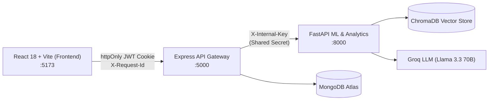

# MoneyLens (मनीलेंस) 🔍💰
> **Personal Financial Intelligence Web Application for Indian Users (INR)**  
> *Final-Year B.Tech AI/ML Capstone Project*

MoneyLens is a privacy-first personal financial intelligence system engineered specifically for Indian salaried professionals, freelancers, and household budgets. It couples deterministic financial math with grounded conversational AI and predictive time-series forecasting.

---

## 🏛️ System Architecture & Perimeter Security



### Perimeter Rules:
1. **Zero Direct Client Exposure**: The browser interacts **only** with the Node.js Express backend (`:5000`). It never communicates directly with MongoDB, ChromaDB, Groq LLM, or the internal FastAPI ML service (`:8000`).
2. **Internal Key Authentication**: All non-health routes on the ML service require the `X-Internal-Key` secret header.
3. **Deterministic Integrity**: All compound interest, savings metrics, and goal scores are calculated in deterministic code. The LLM is restricted to explaining facts and citing approved educational literature.
4. **Strict Educational Scope**: Decision support only. Not SEBI-registered investment, tax, or legal advisory.

---

## 📂 Monorepo Structure

```
Moneylens/
├── .github/workflows/     # CI pipelines (lint, test, build)
├── backend/               # Node.js + Express (API gateway), TypeScript strict mode
│   ├── src/
│   │   ├── config/        # Zod environment validation (fails fast)
│   │   ├── middlewares/   # Request-ID, Pino JSON logger, Central error handler
│   │   ├── routes/        # /api/v1 router & healthcheck
│   │   ├── utils/         # AppError hierarchy, Pino structured logger
│   │   ├── app.ts         # Express app factory
│   │   └── server.ts      # Server lifecycle & graceful shutdown
│   ├── tests/             # Jest + Supertest suites
│   ├── Dockerfile
│   └── package.json
├── frontend/              # React 18 + Vite + TypeScript + Tailwind CSS
│   ├── src/
│   │   ├── components/    # Navbar (live health check), Sidebar, Footer
│   │   ├── pages/         # Dashboard, Transactions, Forecast, Goals, Chat, Auth
│   │   ├── services/      # Type-safe API client (credentials: include)
│   │   └── App.tsx        # React Router configuration
│   ├── Dockerfile
│   └── package.json
├── ml-service/            # Python 3.11 FastAPI (ML & Analytics)
│   ├── app/
│   │   ├── config.py      # Pydantic v2 Settings
│   │   ├── logging_config # JSON structured logger
│   │   ├── middleware.py  # Correlation ID & request duration tracking
│   │   ├── security.py    # X-Internal-Key dependency enforcement
│   │   └── routers/       # /health (public) & /api/v1/internal (protected)
│   ├── tests/             # Pytest test suite (health & security)
│   ├── Dockerfile
│   └── pyproject.toml
├── rag/knowledge/         # Curated financial-education markdown documents
├── docs/                  # Architecture diagrams, API specs, evaluation records
├── docker-compose.yml     # Multi-container orchestration
├── .env.example           # Monorepo environment variable template
└── package.json           # Root orchestration scripts
```

---

## ⚡ Prerequisites

- **Node.js**: `v20.x` or `v24.x`
- **npm**: `v10.x` or `v11.x`
- **Python**: `3.11.x`
- **uv** (recommended) or `pip`
- **Git**

---

## 🚀 Getting Started

### 1. Clone & Configure Environment
```bash
git clone <repo-url>
cd Moneylens

# Copy environment template
cp .env.example .env
```

### 2. Install Dependencies

#### Backend (Node.js):
```bash
cd backend
npm install
cd ..
```

#### ML Service (Python 3.11):
```bash
cd ml-service
uv venv --python 3.11
# Windows PowerShell:
.\.venv\Scripts\activate
# Linux/macOS:
# source .venv/bin/activate
uv pip install -r requirements.txt
cd ..
```

#### Frontend (React / Vite):
```bash
cd frontend
npm install
cd ..
```

---

## 🧪 Running Tests & Validations

Execute test suites across all services:

### Backend Tests (Jest + Supertest):
```bash
cd backend
npm test
```
*Validates: `/api/v1/health` status 200, request ID propagation, and standard 404 JSON error schemas.*

### ML Service Tests (Pytest):
```bash
cd ml-service
.\.venv\Scripts\activate
pytest -v
```
*Validates: `/health` status, model version dictionary, 401 on missing `X-Internal-Key`, 403 on invalid key, and 200 on authorized gateway calls.*

### Frontend Production Build:
```bash
cd frontend
npm run build
```
*Validates: Strict TypeScript compilation and Vite asset bundling.*

---

## 💻 Running the Services Locally

In three separate terminal windows:

### Terminal 1 — Backend Gateway (Port 5000):
```bash
cd backend
npm run dev
```

### Terminal 2 — ML Analytics Service (Port 8000):
```bash
cd ml-service
.\.venv\Scripts\activate
uvicorn app.main:app --host 0.0.0.0 --port 8000 --reload
```

### Terminal 3 — Frontend UI (Port 5173):
```bash
cd frontend
npm run dev
```
Open [http://localhost:5173](http://localhost:5173) in your browser.

---

## 🐳 Docker Deployment

To launch the complete stack with Docker Compose:
```bash
docker-compose up --build
```
- Frontend: `http://localhost:5173`
- Backend API Gateway: `http://localhost:5000/api/v1/health`
- ML Service: `http://localhost:8000/health` (Internal only, not directly called by frontend)
