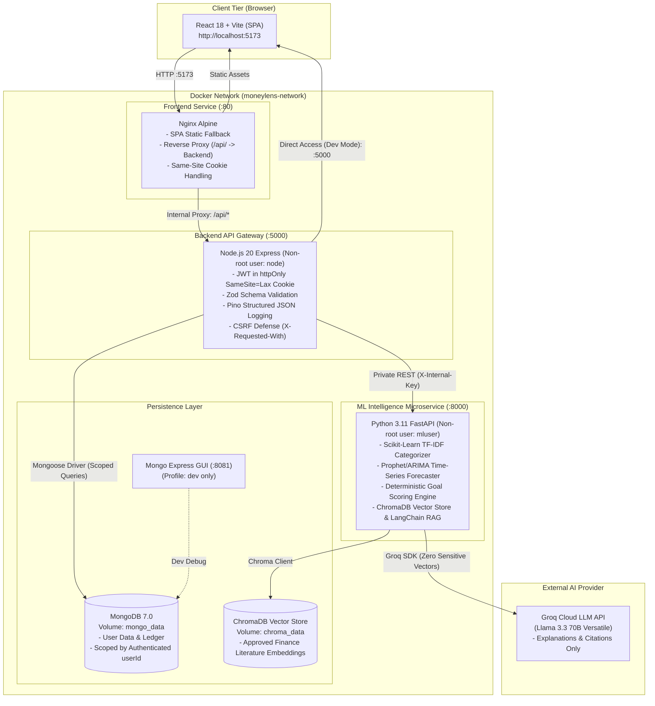
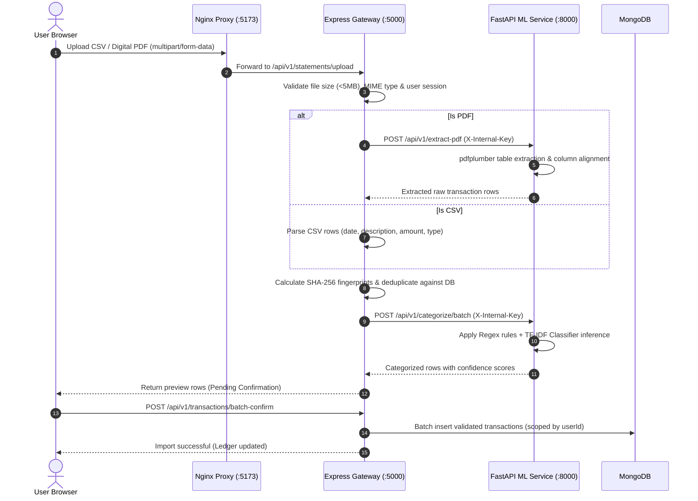
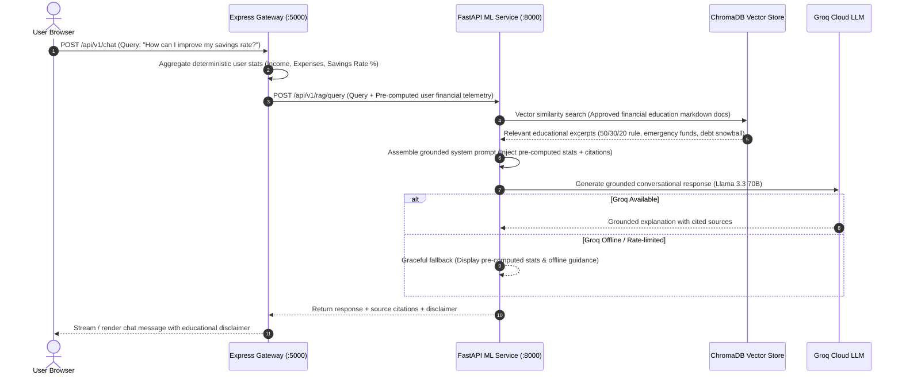

# MoneyLens (मनीलेंस) 🔍💰

> **Personal Financial Intelligence Web Application for Indian Users (INR)**  
> *Final-Year B.Tech Capstone Project (AI/ML & Full-Stack Software Engineering)*

[](https://github.com/Jainaksh23/Moneylens)
[](docs/test_report.md)
[](https://www.typescriptlang.org/)
[](https://www.python.org/)
[](https://fastapi.tiangolo.com/)
[](https://react.dev/)
[](https://www.docker.com/)
[](docs/licenses.md)

MoneyLens is an intelligent, privacy-first personal financial analytics and decision-support web platform engineered specifically for Indian salaried professionals, freelancers, and household budgets. It unites **deterministic mathematical rigor** with **predictive time-series forecasting** and **grounded conversational AI (RAG)** — operating under strict zero-trust perimeter boundaries.

---

## 📑 Table of Contents
1. [Overview & Problem Statement](#-overview--problem-statement)
2. [Key Features](#-key-features)
3. [System Architecture & Security Perimeter](#-system-architecture--security-perimeter)
4. [Process Flowcharts & Workflows](#-process-flowcharts--workflows)
5. [Tech Stack Breakdown](#-tech-stack-breakdown)
6. [Monorepo Directory Structure](#-monorepo-directory-structure)
7. [Installation & Setup Guide](#-installation--setup-guide)
   - [Method 1: Docker Compose (Recommended)](#method-1-docker-compose-recommended)
   - [Method 2: Bare-Metal Local Development](#method-2-bare-metal-local-development)
8. [Environment Configuration (.env)](#-environment-configuration-env)
9. [Step-by-Step User Guide (How to Use)](#-step-by-step-user-guide-how-to-use)
10. [Automated Testing & Security Verification](#-automated-testing--security-verification)
11. [API Contracts & Endpoints](#-api-contracts--endpoints)
12. [Academic & Viva Documentation](#-academic--viva-documentation)
13. [License & Ethical Disclaimer](#-license--ethical-disclaimer)

---

## 💡 Overview & Problem Statement

### The Problem in the Indian Personal Finance Context:
- **UPI Fragmentation**: Day-to-day transactions in India are dominated by micro-payments via UPI (PhonePe, Google Pay, Paytm) with cryptic narratives (e.g., `UPI/409212/SWIGGY/BAN...`), making traditional budgeting tools ineffective.
- **Privacy Invasion**: Most popular Indian financial aggregators harvest and monetize SMS data, upload sensitive records to third-party ad networks, or lock users into opaque proprietary ecosystems.
- **AI Hallucinations in Finance**: Commercial LLMs often hallucinate financial calculations, interest rates, and goal feasibility scores, posing severe risks to financial planning.

### The MoneyLens Solution:
MoneyLens addresses these issues through an engineered, multi-tier architecture:
1. **Privacy-First Zero-Trust Perimeter**: User financial data never touches public vector embeddings or untrusted AI endpoints. The browser interacts only with our secure Node.js API Gateway.
2. **Deterministic Financial Computations**: All compound interest, cash-flow totals, SIP trajectories, and goal achievability scores are computed in deterministic, verifiable code — **never** by an LLM.
3. **Grounded Conversational AI (RAG)**: The conversational assistant is strictly grounded in approved educational literature and pre-computed deterministic metrics, with strict disclaimers that it provides educational decision support, not SEBI-regulated advice.
4. **Active Learning Feedback Loop**: When users correct any transaction category, MoneyLens retains the correction (`categorySource="user"`), preventing machine-learning overrides and feeding future retraining pipelines.

---

## ✨ Key Features

| Feature | Description | Technical Implementation |
| :--- | :--- | :--- |
| **📥 Statement Ingestion** | Ingest Indian bank statements and credit card bills via CSV or digital PDF (`pdfplumber`) with instant deduplication and live preview. | SHA-256 fingerprint deduplication, Zod server-side validation, regex table parsing. |
| **🏷️ Indian ML Categorizer** | Auto-categorizes Indian transaction narratives (Swiggy, Zomato, Zepto, Blinkit, IRCTC, CRED, Zerodha, Rent, EMI) with high confidence. | Hybrid Scikit-Learn TF-IDF classifier + regex heuristic matching with active learning flags. |
| **📊 Real-Time Analytics** | Interactive financial health metrics: Cash Flow, Income vs Expenses, Savings Rate %, 50/30/20 Rule compliance, and category doughnuts. | Aggregated MongoDB pipelines + React Recharts SVG charts. |
| **🔮 Cash-Flow Forecaster** | Projects next 30-90 days cash flow with 95% confidence intervals and historical trend lines. | Time-series modeling (Prophet / ARIMA) compared against naive moving-average baseline. |
| **🎯 Goal Feasibility & SIP Simulator** | Computes goal feasibility score (0–100), required monthly SIP, target shortfall, and slider-driven what-if scenarios. | Deterministic financial math: future value, compound interest formula, and Monte Carlo inflation scenarios. |
| **🚨 Anomaly Detection** | Flags unusual transactions, spending surges, duplicate debits, and sudden spikes with transparent reason codes. | Median Absolute Deviation (MAD) & Z-score statistical anomaly detection. |
| **⏰ Bills & EMI Reminders** | Automatically detects recurring subscriptions, loans, and utility dues, alerting users before due dates. | Frequency interval pattern detection & notification calendar. |
| **💬 Grounded Financial RAG Chat** | Conversational decision support answering financial queries, grounded in approved docs and user stats. | ChromaDB vector store + LangChain retrieval + Groq Cloud LLM (Llama 3.3 70B). |
| **🔒 Data Sovereignty (CAS Export/Purge)** | Full compliance with privacy standards: download complete financial history (JSON/CSV) or wipe data with 1 click. | Cascade atomic deletion across all collections and audit logs. |
| **⚡ Graceful Degradation** | Complete system remains 100% operational even if Groq LLM or ML services are offline or degraded. | Fallback UI cards, offline categorizer heuristics, and deterministic math isolation. |

---

## 🏛️ System Architecture & Security Perimeter

MoneyLens enforces strict multi-tier perimeter isolation. The client browser has **zero direct access** to the database, vector store, ML service, or external AI providers.



### Perimeter Security Invariants:
1. **Zero Client Vector Exposure**: Client browsers communicate exclusively with the Nginx reverse proxy or Express API Gateway. Under no circumstances does the browser call MongoDB, ChromaDB, Groq, or the FastAPI ML microservice directly.
2. **Same-Origin Cookie Hardening**: Authentication uses an `httpOnly`, `Secure` (production), `SameSite=Lax` cookie named `moneylens_token`. It cannot be read or stolen via client-side JavaScript (XSS immune).
3. **Internal Key Authentication**: All non-health internal API calls between Node.js and FastAPI require a shared cryptographic secret header (`X-Internal-Key`).
4. **User-Scoped Queries**: Every single database transaction, read, and write is strictly scoped by `userId` derived from the verified JWT payload. Cross-tenant leakage is mathematically impossible.
5. **Deterministic Integrity**: All financial calculations are deterministic. The LLM is restricted to formatting, summarizing pre-computed facts, and citing verified knowledge documents.

---

## 🔄 Process Flowcharts & Workflows

### 1. Statement Ingestion & Categorization Pipeline


---

### 2. Grounded RAG Chat with Groq Guardrails


---

### 3. Goal Feasibility & SIP What-If Simulator Flow
```mermaid
flowchart TD
    A[User enters Goal: Target ₹10,00,000 in 36 Months] --> B[Fetch User Historic Cash Flow & Median Savings]
    B --> C[Compute Required Monthly SIP: FV = P * (((1+r)^n - 1)/r) * (1+r)]
    C --> D[Evaluate Historical Free Cash Flow vs Required Monthly SIP]
    D --> E[Calculate Achievability Score: 0 to 100]
    E --> F{Score Assessment}
    F -->|Score >= 75| G[Feasibility: High / On Track 🟢]
    F -->|50 <= Score < 75| H[Feasibility: Moderate / Needs Minor Adjustments 🟡]
    F -->|Score < 50| I[Feasibility: Low / Action Required 🔴]
    G & H & I --> J[Generate Interactive What-If Sliders]
    J --> K[User adjusts: Duration (+6 mo), Target Amount, or Monthly SIP]
    K --> L[Instant Deterministic Re-calculation in Frontend/Backend]
```

---

## 💻 Tech Stack Breakdown

### Frontend Tier
- **Framework**: [React 18](https://react.dev/) + [Vite](https://vitejs.dev/) (Single Page Application)
- **Language**: [TypeScript](https://www.typescriptlang.org/) (Strict type safety, zero `any`)
- **Styling**: [Tailwind CSS](https://tailwindcss.com/) with sleek dark-mode glassmorphism
- **Icons**: [Lucide React](https://lucide.dev/)
- **Data Visualization**: [Recharts](https://recharts.org/) (Responsive SVG area, bar, and doughnut charts)
- **Testing**: [Vitest](https://vitest.dev/) + React Testing Library

### Backend API Gateway Tier
- **Runtime**: [Node.js 20 LTS](https://nodejs.org/) (Runs as unprivileged user `node`)
- **Framework**: [Express.js](https://expressjs.com/)
- **Language**: TypeScript (`strict: true`)
- **Validation**: [Zod](https://zod.dev/) (Comprehensive request schema validation)
- **Database ODM**: [Mongoose](https://mongoosejs.com/) (MongoDB 7.0)
- **Logging**: [Pino](https://getpino.io/) (High-performance structured JSON logs)
- **Authentication**: JWT stored in `httpOnly`, `SameSite=Lax` cookies with `bcrypt` hashing
- **Testing**: [Jest](https://jestjs.io/) + [Supertest](https://github.com/ladjs/supertest)

### Machine Learning & Intelligence Tier
- **Framework**: [Python 3.11](https://www.python.org/) + [FastAPI](https://fastapi.tiangolo.com/) (Runs as user `mluser`)
- **Validation**: [Pydantic v2](https://docs.pydantic.dev/)
- **PDF Extraction**: [pdfplumber](https://github.com/jsvine/pdfplumber) (High-fidelity tabular digital PDF parser)
- **Categorization**: [Scikit-Learn](https://scikit-learn.org/) (TF-IDF vectorizer + Logistic Regression) + Regex heuristics
- **Forecasting**: [Prophet](https://facebook.github.io/prophet/) & statsmodels ARIMA with naive baseline comparison
- **Vector Store**: [ChromaDB](https://www.trychroma.com/) with pre-downloaded ONNX embedding models
- **LLM Orchestration**: [LangChain](https://www.langchain.com/) + [Groq Cloud SDK](https://groq.com/) (`llama-3.3-70b-versatile`)
- **Testing**: [Pytest](https://docs.pytest.org/) + `httpx.AsyncClient`

### DevOps & Infrastructure
- **Containerization**: [Docker](https://www.docker.com/) & Docker Compose (Multi-stage builds, non-root users)
- **Reverse Proxy**: [Nginx Alpine](https://nginx.org/) (Reverse proxy, SPA router, security headers)
- **CI/CD**: GitHub Actions automated pipeline (Linting, unit tests, integration tests)
- **Cloud Deployment Ready**: Render (`render.yaml`) & Vercel (`vercel.json`) compatible

---

## 📂 Monorepo Directory Structure

```text
Moneylens/
├── .github/
│   └── workflows/
│       └── ci.yml                     # GitHub Actions CI workflow (Node, Python, Docker)
├── backend/                           # Node.js + Express API Gateway
│   ├── src/
│   │   ├── config/                    # Environment & MongoDB database configuration
│   │   ├── controllers/               # Business logic (Auth, Transactions, Goals, Analytics)
│   │   ├── middlewares/               # Auth, CSRF, error handler, structured Pino logger
│   │   ├── models/                    # Mongoose schemas (User, Transaction, Goal, Anomaly)
│   │   ├── routes/                    # Express REST route definitions (/api/v1)
│   │   ├── services/                  # ML microservice HTTP client & calculation utilities
│   │   ├── app.ts                     # Express application factory
│   │   └── server.ts                  # HTTP server bootstrap & graceful shutdown
│   ├── tests/                         # Jest + Supertest test suites (123 tests)
│   ├── Dockerfile                     # Multi-stage production container build (user: node)
│   ├── package.json                   # Backend dependencies and scripts
│   └── tsconfig.json                  # Strict TypeScript configuration
├── frontend/                          # React 18 + Vite Web Application
│   ├── src/
│   │   ├── components/                # Reusable UI components (Navbar, Sidebar, Charts, Modals)
│   │   ├── context/                   # AuthContext, ThemeContext, NotificationContext
│   │   ├── pages/                     # Application pages (Dashboard, Ledger, Goals, Chat, etc.)
│   │   ├── services/                  # API client calling /api/v1 (with credentials)
│   │   ├── types/                     # Shared TypeScript interfaces & types
│   │   ├── App.tsx                    # Main router & layout configuration
│   │   └── main.tsx                   # React DOM root entry point
│   ├── tests/                         # Vitest + RTL component tests (14 tests)
│   ├── nginx.conf                     # Production Nginx reverse proxy configuration
│   ├── Dockerfile                     # Multi-stage Nginx container build
│   └── package.json                   # Frontend dependencies
├── ml-service/                        # Python FastAPI Intelligence Microservice
│   ├── app/
│   │   ├── core/                      # Configuration, settings, security middleware
│   │   ├── models/                    # Pydantic v2 schemas for requests & responses
│   │   ├── routers/                   # FastAPI routers (categorize, forecast, goals, RAG)
│   │   ├── services/                  # ML engines: Categorizer, Forecaster, GoalScorer, PDF
│   │   └── main.py                    # FastAPI application initialization
│   ├── tests/                         # Pytest test suites (82 tests)
│   ├── Dockerfile                     # Production container build with pre-cached ONNX models
│   └── requirements.txt               # Python package dependencies
├── rag/
│   └── knowledge/                     # Approved financial education literature (.md)
│       ├── budgeting_rules.md         # 50/30/20 budget framework & emergency funds
│       ├── debt_management.md         # Debt snowball vs avalanche methods
│       └── investment_basics.md       # SIP, mutual funds, inflation & compound interest
├── docs/                              # Project documentation & Academic deliverables
│   ├── api.md                         # Complete REST API specification
│   ├── architecture.md                # Detailed architecture & security principles
│   ├── data_dictionary.md             # Database schemas & field descriptions
│   ├── demo_script.md                 # 10-Minute live demonstration & failure-mode script
│   ├── deployment.md                  # Comprehensive production deployment guide
│   ├── evaluation.md                  # Empirical evaluation metrics & baseline comparisons
│   ├── goal_score.md                  # Mathematical formulation of goal scoring & SIP
│   ├── privacy.md                     # Data privacy, CAS export & GDPR purge policies
│   ├── screenshots.md                 # Screen catalog & UI interaction flows
│   ├── submission_checklist.md        # Academic submission verification checklist
│   ├── test_report.md                 # 219/219 automated test run report
│   ├── viva_questions.md              # 25+ Capstone Viva examination Q&A guide
│   └── sample_transactions.csv        # Realistic synthetic dataset (670 Indian transactions)
├── scripts/
│   ├── smoke_test.js                  # Automated containerized health & workflow check
│   ├── e2e_full_flow.js               # End-to-end full user journey simulation
│   └── generate_synthetic_data.py     # Script to generate realistic Indian financial data
├── docker-compose.yml                 # Master development container orchestration
├── docker-compose.prod.yml            # Production container configuration & log rotation
├── .env.example                       # Documented environment variable template
├── package.json                       # Monorepo root scripts & test runners
└── README.md                          # Project master documentation
```

---

## 🚀 Installation & Setup Guide

### Prerequisites
- **Git**: Installed and configured
- **Docker & Docker Compose**: v2.20+ (Recommended)
- **Node.js**: v20.x or v22.x LTS (For bare-metal local dev)
- **Python**: 3.11.x (For bare-metal local dev)
- **MongoDB**: v7.0 (Local instance or free MongoDB Atlas cluster)

---

### Method 1: Docker Compose (Recommended)

Run the entire multi-tier stack with a single command:

```bash
# 1. Clone the repository
git clone https://github.com/Jainaksh23/Moneylens.git
cd Moneylens

# 2. Copy the environment configuration template
cp .env.example .env

# 3. (Optional) Edit .env to add your free Groq API key:
# GROQ_API_KEY=gsk_your_groq_api_key_here

# 4. Build and start all services in detached mode
docker compose up -d --build

# 5. Verify all containers are healthy
docker compose ps
```

#### 🌐 Active Service Endpoints:
- **Frontend Web UI**: [http://localhost:5173](http://localhost:5173)
- **Backend API Gateway**: [http://localhost:5000/api/v1/health](http://localhost:5000/api/v1/health)
- **Backend Readiness Probe**: [http://localhost:5000/health/ready](http://localhost:5000/health/ready)
- **Database GUI (Mongo Express)**: [http://localhost:8081](http://localhost:8081) *(Start with `--profile dev`)*

---

### Method 2: Bare-Metal Local Development

If developing without Docker containers, launch each service in its own terminal:

#### Step 1: Start MongoDB
Ensure a local MongoDB daemon is running at `mongodb://localhost:27017/moneylens`.

#### Step 2: Launch Backend API Gateway
```bash
cd backend
npm install
npm run dev
# Server will start on http://localhost:5000
```

#### Step 3: Launch ML & Intelligence Microservice
```bash
cd ml-service
python -m venv .venv

# On Windows (PowerShell):
.\.venv\Scripts\activate
# On Linux / macOS:
source .venv/bin/activate

pip install -r requirements.txt
uvicorn app.main:app --host 0.0.0.0 --port 8000 --reload
# ML Service will start on http://localhost:8000
```

#### Step 4: Launch Frontend UI
```bash
cd frontend
npm install
npm run dev
# Frontend Vite dev server will start on http://localhost:5173
```

---

## ⚙️ Environment Configuration (.env)

The root `.env.example` provides default configuration values for both Docker and local setups:

| Variable | Default Value | Description |
| :--- | :--- | :--- |
| `NODE_ENV` | `development` | Environment mode (`development` or `production`). |
| `FRONTEND_PORT` | `5173` | Host port mapped to Frontend Nginx service. |
| `BACKEND_PORT` | `5000` | Host port mapped to Node.js Express API gateway. |
| `MONGODB_URI` | `mongodb://mongo:27017/moneylens` | MongoDB connection URI (`mongodb://localhost:27017/moneylens` for bare-metal). |
| `JWT_SECRET` | *32+ character random string* | Secret used for cryptographic signing of session JWTs. |
| `COOKIE_NAME` | `moneylens_token` | Name of the secure httpOnly authentication cookie. |
| `ALLOWED_ORIGINS` | `http://localhost:5173,http://127.0.0.1:5173` | CORS allowed origins. |
| `INTERNAL_API_KEY` | *32+ character random string* | Shared cryptographic secret (`X-Internal-Key`) for Backend <-> FastAPI traffic. |
| `GROQ_API_KEY` | `gsk_your_groq_api_key` | Free Groq API key for conversational AI ([Get key](https://console.groq.com/keys)). |
| `GROQ_MODEL` | `llama-3.3-70b-versatile` | Model used for grounded educational chat. |
| `CHROMA_PERSIST_DIR` | `/app/chroma_data` | Directory where ChromaDB vector embeddings are persisted. |

---

## 📖 Step-by-Step User Guide (How to Use)

### 1. Account Creation & Onboarding
1. Navigate to [http://localhost:5173](http://localhost:5173).
2. Click **"Get Started"** or **"Register"**.
3. Enter your Name, Email, and a strong password (minimum 8 characters, at least 1 letter, 1 number).
4. Complete the 3-step onboarding wizard: set currency to **INR (₹)**, define a target savings percentage, and proceed to the dashboard.

### 2. Ingesting Financial Statements
1. Go to the **Transactions** page from the sidebar.
2. Click the **"Import Statement"** button.
3. Select your statement type:
   - **CSV**: Upload [`docs/sample_transactions.csv`](docs/sample_transactions.csv) (includes 670 realistic Indian salary, UPI, food, rent, and utility transactions).
   - **Digital PDF**: Upload an official digital bank statement PDF.
4. Review the parsed transactions in the live preview table:
   - Notice that Swiggy/Zomato are auto-tagged as `Food & Dining`.
   - Zerodha/Groww transactions are tagged as `Investment`.
   - Salary credits are tagged as `Income`.
5. Click **"Confirm Import"** to persist the transactions into your ledger.

### 3. Active Learning: Correcting Categories
1. In the Transactions table, find any transaction you wish to re-classify.
2. Click the category dropdown and select a new category (e.g., change `Shopping` to `Entertainment`).
3. Click **"Save Changes"**.
4. The system flags this entry with `categorySource="user"`. Future heuristics and model retraining respect this preference.

### 4. Exploring the Financial Health Dashboard
1. Navigate to **Dashboard** (`/dashboard`).
2. Examine the top KPI telemetry cards:
   - **Total Income**, **Total Expenses**, **Net Savings**, and **Savings Rate %**.
3. View the **Spending Trajectory Area Chart** (Income vs. Expense trends).
4. Review the **50/30/20 Rule Analysis** card: calculates your Needs (50%), Wants (30%), and Savings (20%) breakdown against gold standard financial principles.

### 5. Goal Planning & SIP What-If Simulator
1. Navigate to **Goals** (`/goals`).
2. Click **"Create New Goal"** (e.g., "Emergency Fund", Target: ₹3,00,000, Target Date: 24 months).
3. The deterministic math engine computes:
   - **Goal Achievability Score** (0 to 100).
   - **Required Monthly SIP** (based on expected return rates).
   - **Projected Shortfall or Surplus**.
4. Use the **Interactive What-If Sliders** to adjust the monthly investment or target date and observe the score recalculate in real-time.

### 6. Anomalies & Recurring Reminders
1. Open the **Insights** page to view detected spending anomalies (e.g., a sudden ₹15,000 electronics expense).
2. Click **"Mark as Expected"** if the expense was an intentional one-off purchase.
3. Navigate to **Reminders** to view upcoming recurring bills, SIP debits, and loan EMIs detected from your transaction history.

### 7. Grounded Financial AI Chatbot
1. Open the **Financial Assistant** chat tab.
2. Ask questions such as:
   - *"How does my current savings rate compare to the 50/30/20 rule?"*
   - *"What are some practical ways I can optimize my food and dining expenses?"*
   - *"Explain the difference between debt avalanche and debt snowball methods."*
3. The chatbot responds using pre-computed statistics from your own ledger and cites approved literature from `rag/knowledge/`.
4. Note the educational disclaimer attached to every message.

### 8. Data Sovereignty: Export & Permanent Purge
1. Go to **Settings** (`/profile`).
2. Click **"Export Consolidated Account Statement (CAS)"** to download your complete data as JSON or CSV.
3. Click **"Purge All Data"** to execute a permanent cascade delete of all your personal data, transactions, goals, and chat histories across MongoDB.

---

## 🧪 Automated Testing & Security Verification

MoneyLens features an exhaustive **219/219 automated test suite** with 100% pass rate across all tiers:

```
========================= MONOREPO TEST SUMMARY =========================
  Backend Test Suite (Jest + Supertest):         123 / 123 PASSED (100%)
  ML Intelligence Test Suite (Pytest):            82 /  82 PASSED (100%)
  Frontend Test Suite (Vitest + RTL):             14 /  14 PASSED (100%)
  End-to-End Simulation Runner:                   10 /  10 STAGES PASSED
  -----------------------------------------------------------------------
  Total Automated Tests:                         219 / 219 PASSED (100%)
=========================================================================
```

### Running the Tests:

```bash
# 1. Run all tests across the monorepo:
npm test

# 2. Run backend tests only:
npm run test:backend

# 3. Run frontend tests only:
npm run test:frontend

# 4. Run ML service tests only:
npm run test:ml

# 5. Run end-to-end containerized smoke test:
npm run test:smoke

# 6. Run full user simulation flow (Registration -> Ingestion -> Goals -> RAG -> Purge):
npm run test:e2e
```

### Dedicated Security & Adversarial Regression Suite
The backend includes a dedicated security test suite ([`backend/tests/security_regression.test.ts`](backend/tests/security_regression.test.ts)) that validates:
- **Multi-Tenant Isolation**: Confirms User Beta cannot read, edit, or delete User Alpha's transactions, goals, anomalies, or chat logs.
- **Injection Defenses**: Validates safe rejection of adversarial IDs (`' OR 1=1 --`, `<script>alert(1)</script>`, `../../etc/passwd`).
- **Buffer & Size Limits**: Verifies rejection of payloads > 1MB and CSVs > 5MB.
- **CORS & Origin Hardening**: Confirms rejection of unauthorized cross-site origins.
- **Cookie Security Flags**: Asserts `httpOnly`, `path=/`, and `SameSite=Lax` flags on all issued session cookies.

---

## 🔌 API Contracts & Endpoints

A summary of primary API routes (Detailed specifications in [`docs/api.md`](docs/api.md)):

| Method | Endpoint | Description | Auth Required |
| :--- | :--- | :--- | :---: |
| `GET` | `/api/v1/health` | Public liveness health check probe | ❌ |
| `GET` | `/api/v1/health/ready` | Backend readiness probe (verifies DB connection) | ❌ |
| `POST` | `/api/v1/auth/register` | Register new user account & set session cookie | ❌ |
| `POST` | `/api/v1/auth/login` | Authenticate user & issue httpOnly cookie | ❌ |
| `POST` | `/api/v1/auth/logout` | Clear session cookie | ✅ |
| `GET` | `/api/v1/auth/me` | Fetch authenticated user profile | ✅ |
| `POST` | `/api/v1/statements/upload` | Parse CSV / PDF statement & preview categorized rows | ✅ |
| `POST` | `/api/v1/transactions/batch-confirm` | Bulk confirm & persist previewed transactions | ✅ |
| `GET` | `/api/v1/transactions` | Query ledger with search, category & date filters | ✅ |
| `PATCH` | `/api/v1/transactions/:id` | Update transaction (user active learning recategorization) | ✅ |
| `GET` | `/api/v1/analytics/overview` | Fetch income, expenses, savings rate & 50/30/20 stats | ✅ |
| `GET` | `/api/v1/forecast` | Retrieve 30/60/90-day cash-flow forecast & confidence bounds | ✅ |
| `GET` | `/api/v1/goals` | List all savings goals with achievability scores | ✅ |
| `POST` | `/api/v1/goals/:id/simulate` | Run SIP what-if simulation with adjusted parameters | ✅ |
| `GET` | `/api/v1/insights/anomalies` | Fetch detected spending anomalies & surge alerts | ✅ |
| `POST` | `/api/v1/chat` | Send conversational query to grounded RAG engine | ✅ |
| `GET` | `/api/v1/profile/export` | Download Consolidated Account Statement (CAS JSON/CSV) | ✅ |
| `DELETE`| `/api/v1/profile/purge` | Permanently wipe all user data (Right to be Forgotten) | ✅ |

---

## 🎓 Academic & Viva Documentation

Engineered as a Final-Year B.Tech Capstone Project, MoneyLens includes comprehensive academic documentation ready for review:

- **[Viva Examination Guide (25+ In-Depth Q&As)](docs/viva_questions.md)**: Thorough explanations covering machine learning models, statistical trade-offs, architecture choices, perimeter security, and edge cases.
- **[10-Minute Live Demo Script](docs/demo_script.md)**: Minute-by-minute evaluation walkthrough including a deliberate failure-state demonstration showing how the application degrades gracefully when AI is disconnected.
- **[System Architecture Document](docs/architecture.md)**: Formal architectural documentation detailing service topologies and threat models.
- **[Empirical Evaluation Report](docs/evaluation.md)**: Reproducible ML metrics comparing TF-IDF categorization against naive keyword search, and Prophet forecasting against moving averages.
- **[Data Dictionary](docs/data_dictionary.md)**: Complete database schema specifications, field types, and indexing strategies.
- **[Submission Checklist](docs/submission_checklist.md)**: Pre-submission verification matrix confirming all deliverables are satisfied.

---

## ⚖️ License & Ethical Disclaimer

### MIT License
This project is open-source and distributed under the terms of the [MIT License](docs/licenses.md).

### Educational Decision Support Disclaimer
> **IMPORTANT NOTICE**: MoneyLens is designed exclusively for educational, academic, and computational decision-support purposes. MoneyLens is **not** a SEBI-registered investment advisor, portfolio management service, tax consultant, or legal counsel under the laws of India. None of the charts, scores, forecasts, or chatbot responses constitute regulated financial, legal, or investment advice. Users should consult licensed financial advisors before making substantial investment decisions.
