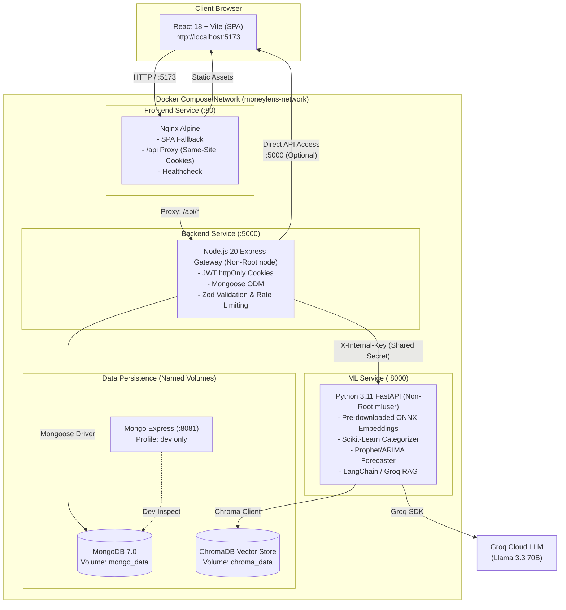

# MoneyLens (मनीलेंस) 🔍💰
> **Personal Financial Intelligence Web Application for Indian Users (INR)**  
> *Final-Year B.Tech AI/ML Capstone Project*

MoneyLens is a privacy-first personal financial intelligence system engineered specifically for Indian salaried professionals, freelancers, and household budgets. It couples deterministic financial math with grounded conversational AI and predictive time-series forecasting.

---

## 🏛️ System Architecture & Perimeter Security



### Perimeter Security Rules:
1. **Zero Direct Client Exposure**: The browser interacts **only** with the frontend Nginx reverse proxy (`:5173`) or the backend API gateway (`:5000`). It never communicates directly with MongoDB, ChromaDB, Groq LLM, or the internal FastAPI ML service (`:8000`).
2. **Same-Origin / Same-Site Cookies**: Nginx proxies all `/api/` traffic to `http://backend:5000/api/`. Browsers send and receive the `moneylens_token` authentication cookie as same-origin, completely eliminating third-party cookie restrictions and CORS preflight latency.
3. **Internal Key Authentication**: All non-health routes on the ML service require the `X-Internal-Key` secret header.
4. **Deterministic Integrity**: All compound interest, savings metrics, and goal scores are calculated in deterministic code. The LLM is restricted to explaining facts and citing approved educational literature.
5. **Non-Root Containers**: Both `backend` (runs as user `node`) and `ml-service` (runs as user `mluser`) execute with unprivileged user accounts.

---

## ⚡ Prerequisites

- **Docker & Docker Compose**: v2.20+ (recommended for full-stack deployment)
- **Node.js**: v20.x or v22.x (for local development without Docker)
- **Python**: 3.11.x (for local ML service development without Docker)
- **Git**

---

## 🚀 Quickstart with Docker Compose

Launch the entire containerized stack with a single command:

```bash
# 1. Clone repository and change to workspace root
git clone <repo-url>
cd Moneylens

# 2. Copy the environment configuration template
cp .env.example .env

# 3. Validate Docker Compose configuration
docker compose config

# 4. Build and start all services in detached mode
docker compose up -d --build

# 5. Verify all service containers are healthy
docker compose ps
```

### Active Service Endpoints:
- **Frontend Web UI**: [http://localhost:5173](http://localhost:5173)
- **Backend API Gateway**: [http://localhost:5000/api/v1/health](http://localhost:5000/api/v1/health)
- **Backend Readiness Probe**: [http://localhost:5000/health/ready](http://localhost:5000/health/ready)
- **Database GUI (Mongo Express)**: [http://localhost:8081](http://localhost:8081) *(when started with `--profile dev`)*

---

## 🧪 Running Tests & Validations

### 1. Automated End-to-End Container Smoke Test
Verify the running containerized system end-to-end (Health probe → User registration → Profile retrieval → CSV upload preview → Batch confirm → Dashboard analytics aggregation → Cleanup):

```bash
# Via npm script:
npm run test:smoke

# Or directly via Node:
node scripts/smoke_test.js

# Or via Shell script (Linux/macOS):
bash scripts/smoke_test.sh
```

### 2. Backend Test Suite (Jest + Supertest)
```bash
cd backend
npm test
```
*Validates 9 test suites (121 tests): Authentication, Profile / CAS Export & Purge, Transactions & Deduplication, Analytics Aggregations, Cash-Flow Forecast & Goals, Anomaly Insights & Reminders, RAG Financial Chat & Grounded Security, and Health Readiness probes.*

### 3. Frontend Test Suite (Vitest)
```bash
cd frontend
npm test
```
*Validates 4 test suites (14 tests): Protected routing redirects, authentication forms & password policies, interaction filters, and UI loading/error states.*

### 4. ML Service Test Suite (Pytest)
```bash
cd ml-service
pytest -v
```
*Validates 9 test suites (77 tests): Health & model readiness probes, internal key authentication, transaction categorization, time-series forecasting, goal feasibility scoring, anomaly detection, and RAG vector store retrieval.*

### 5. Run Full End-to-End Verification Flow
```bash
# Complete end-to-end user simulation (register -> CSV import -> what-if -> RAG chat -> purge):
node scripts/e2e_full_flow.js

# Post-deploy live production smoke test (Render/Vercel):
node scripts/post_deploy_smoke.js https://moneylens.vercel.app
```

---

## 🛠️ Building & Packaging

### Production Container Build
```bash
# Build all Docker images without starting containers
docker compose build

# Rebuild without caching
docker compose build --no-cache
```

### Standalone Local Builds
```bash
# Compile Backend TypeScript to dist/
npm run build:backend

# Build Frontend Vite assets into dist/
npm run build:frontend
```

---

## 💻 Running Locally (Bare Metal / Dev Mode)

If you prefer to run services on your host machine without Docker:

### 1. MongoDB
Start a local MongoDB instance on `mongodb://localhost:27017/moneylens`.

### 2. Backend Gateway (Port 5000)
```bash
cd backend
npm install
npm run dev
```

### 3. ML Analytics Service (Port 8000)
```bash
cd ml-service
python -m venv .venv
# Windows PowerShell:
.\.venv\Scripts\activate
# Linux/macOS:
source .venv/bin/activate
pip install -r requirements.txt
uvicorn app.main:app --host 0.0.0.0 --port 8000 --reload
```

### 4. Frontend UI (Port 5173)
```bash
cd frontend
npm install
npm run dev
```

---

## 📜 Managing Logs

Inspect live container logs during development or debugging:

```bash
# Follow logs for all services simultaneously
docker compose logs -f

# Follow logs for a specific service
docker compose logs -f backend
docker compose logs -f ml-service
docker compose logs -f frontend
docker compose logs -f mongo

# Show the last 100 log lines without streaming
docker compose logs --tail=100 backend
```

---

## 🔄 Resetting Development Data

To completely reset the database, vector store, and test state to a clean slate:

```bash
# 1. Stop containers and destroy named persistent volumes (mongo_data, chroma_data)
docker compose down -v

# 2. Restart services with fresh, clean volumes
docker compose up -d --build
```

---

## 🏭 Production Deployment

For production deployments, use the production compose override which enables log rotation policies, strict restart policies, and production configurations:

```bash
# Launch with production configuration
docker compose -f docker-compose.yml -f docker-compose.prod.yml up -d --build

# Check status
docker compose -f docker-compose.yml -f docker-compose.prod.yml ps
```

---

## 🩺 Healthchecks & Readiness Probes

All services implement explicit health check endpoints:

| Service | Liveness Probe | Readiness Probe | Check Details |
| :--- | :--- | :--- | :--- |
| **Backend** | `GET /health` | `GET /health/ready` | Verifies Mongoose connection `readyState === 1`. Does not leak internal hostnames or credentials. |
| **ML Service** | `GET /health` | `GET /health/ready` | Verifies ML models (Categorizer, Forecaster) are loaded in memory and ready for inference. |
| **Frontend** | `GET /health` | N/A | Verifies Nginx reverse proxy is actively accepting connections. |
| **MongoDB** | `mongosh ping` | N/A | Native MongoDB healthcheck via `db.runCommand("ping").ok`. |

---

## ❓ Troubleshooting

### 1. Port Conflicts (e.g. `port 5173 or 5000 already in use`)
If your host already has services listening on port 5173 or 5000, edit your `.env` file to customize the exposed host ports:
```bash
FRONTEND_PORT=5180
BACKEND_PORT=5050
MONGO_EXPRESS_PORT=8090
```
Then run `docker compose up -d`.

### 2. Services Stuck Waiting on `service_healthy`
Check the health status of dependent services:
```bash
docker compose ps
docker compose logs mongo
docker compose logs ml-service
```
Common causes:
- MongoDB taking longer than 10s to initialize on low-spec hardware. The healthcheck retries up to 5 times.
- `ml-service` ONNX embedding model downloading on cold start (resolved in production Dockerfile by pre-downloading during image build).

### 3. Cookies Not Stored in Browser
- In Docker, ensure you access the app via `http://localhost:5173`. Nginx proxies all `/api/` calls same-origin, ensuring cookies are preserved.
- If accessing via a custom domain over HTTPS, ensure `NODE_ENV=production` is set in `.env` so cookies have the `secure` flag enabled.

### 4. Groq API Key Not Set / RAG Chat Disabled
If `GROQ_API_KEY` is not provided in `.env`:
- Financial calculations, transaction imports, categorizations, and forecasts continue to work normally.
- Financial chatbot responses fallback gracefully with a clear setup message explaining that Groq LLM credentials are required for conversational advice.
- Obtain a free key at [console.groq.com/keys](https://console.groq.com/keys) and update `.env`.

---

## ⚖️ License & Disclaimer

MoneyLens is created for academic, capstone, and educational demonstrations. It provides computational decision support and financial pattern visualization. **MoneyLens is not a SEBI-registered investment advisor, financial planner, tax consultant, or legal counsel.**
