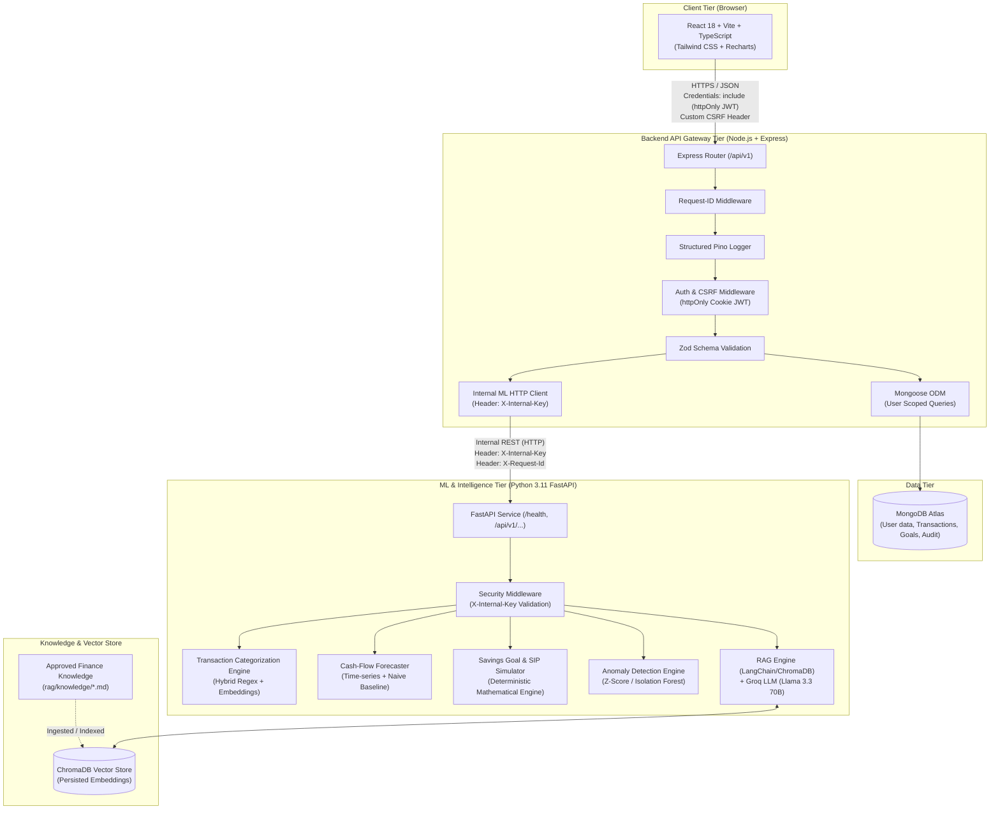

# MoneyLens System Architecture

MoneyLens is a Personal Financial Intelligence Web Application tailored for Indian users (INR), designed with strict security boundaries, isolated analytical computation, and educational decision support.

## High-Level Architecture Diagram

## Security & Architecture Principles

1. **Strict Perimeter Isolation**:
   - The browser communicates **exclusively** with the Node.js Express backend.
   - The browser never communicates directly with MongoDB, the FastAPI ML service, or external LLM providers (Groq).
   - The FastAPI ML service is non-public and protected by a shared secret header `X-Internal-Key`.
2. **Authentication & Session Security**:
   - JWT tokens are stored exclusively in `httpOnly`, `Secure`, and `SameSite` cookies to prevent XSS exfiltration.
   - All state-changing requests enforce CSRF protection via SameSite cookies combined with custom request header validation.
3. **Database Scoping**:
   - Every single MongoDB query is explicitly scoped by the authenticated user's `userId`.
4. **Deterministic Financial Computations**:
   - Financial figures, cash-flow projections, compound interest, and goal scores are calculated deterministically in code (Node/Python). The LLM is never relied on for mathematical calculation; it only provides grounded explanations of pre-computed numbers.
5. **Traceability & Logging**:
   - Structured JSON logging (`pino` in Node, JSON format in Python) tracks `requestId`, route, HTTP status, and response duration across service hops.
   - No PII, passwords, bank account numbers, or raw financial files are ever logged.
6. **Graceful Degradation**:
   - If the ML service or LLM provider experiences an outage, core transactional and budgeting features remain operational, and the UI displays clear informational status cards.
